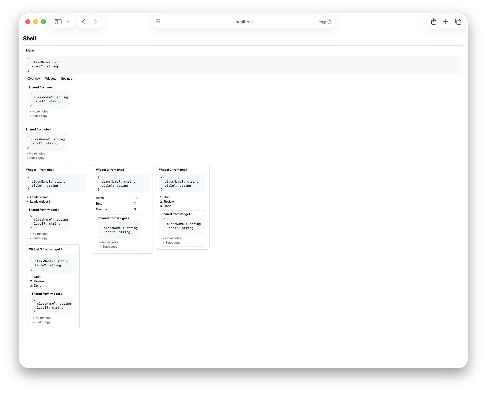
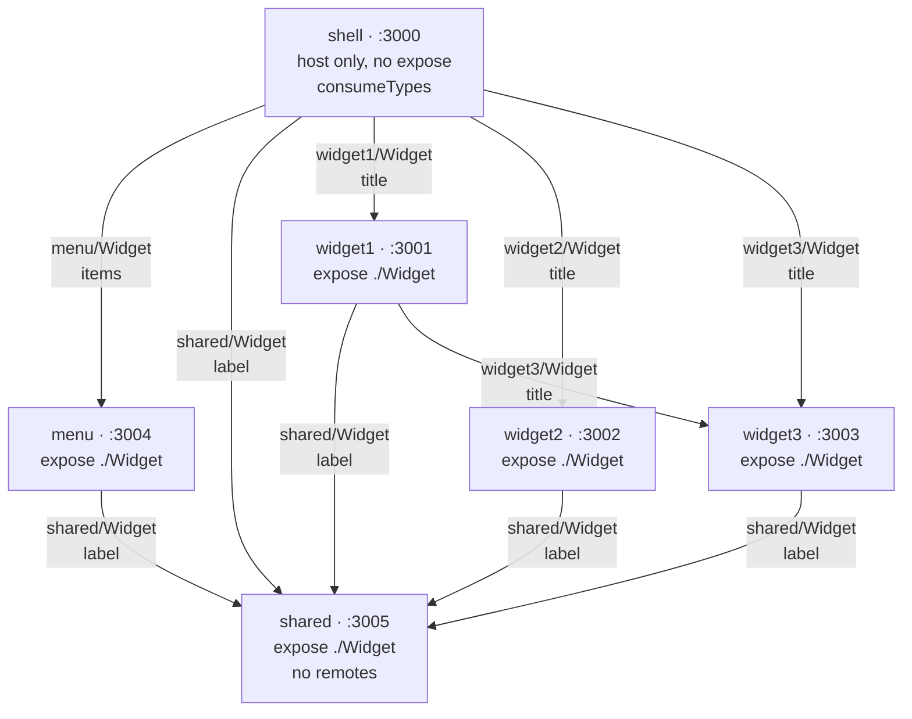
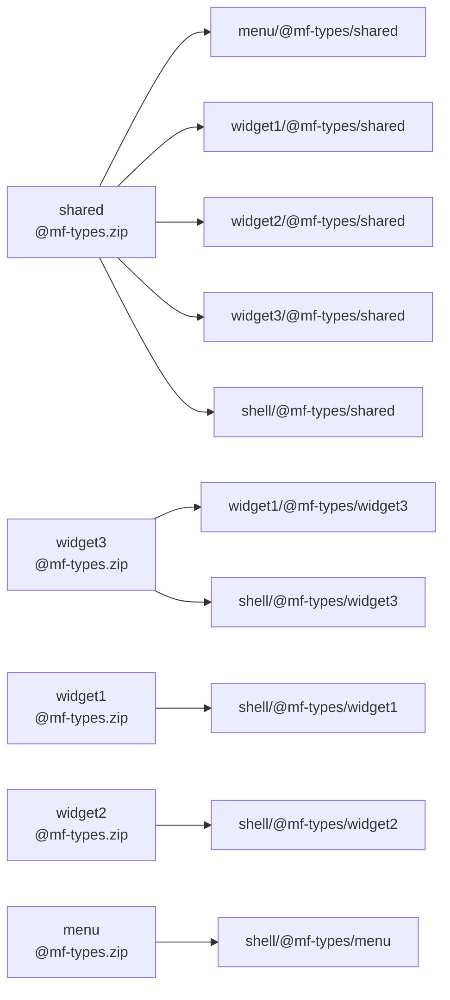

# mf-dashboard-tests

[English](README.md) | [Русский](README.ru.md)

This repository is for testing [mf-dashboard](https://github.com/megahoma/mf-dashboard).

A shell, a menu, three widgets, and one shared remote. React 19, TypeScript, Rsbuild, Module Federation 2. Screens show static copy and props. There are no external requests.



## Graph

The browser opens `shell` on port 3000. An arrow is a runtime load. The host reads `mf-manifest.json` on the remote port, then the `remoteEntry.js` that manifest names, then renders the expose `./Widget`. Every such render sits in its own `Suspense` and `RemoteBoundary`. `className` is optional. The label on an arrow is the other prop that parent passes.



On the shell page, `shared` renders six times: from the shell, from the menu, from each of the three widgets, and once more from the `widget3` that `widget1` loads. Those are separate renders of one remote.

A producer with `generateTypes` publishes `@mf-types.zip`. A consumer with `consumeTypes` copies that zip into `@mf-types/<remote>`. After a change to `shared`, those copies update once `shared` rebuilds the zip and each consumer downloads it. A consumer's own zip describes its own props. Props from `shared` are not copied into it. The shell does not publish a zip.



## Requirements

- Node.js 20.19 or newer
- pnpm 10.34.5

```bash
corepack enable
corepack prepare pnpm@10.34.5 --activate
pnpm install
```

## Run

```bash
pnpm dev
```

`pnpm dev` starts all six servers. The ports are fixed. `remotes` point at `http://127.0.0.1:<port>/mf-manifest.json`. The pages also open on `localhost`.

| App | URL | Role |
|---|---|---|
| shell | http://localhost:3000 | Host |
| widget-1 | http://localhost:3001 | Loads shared and widget-3 |
| widget-2 | http://localhost:3002 | Loads shared |
| widget-3 | http://localhost:3003 | Loads shared |
| menu | http://localhost:3004 | Loads shared |
| shared | http://localhost:3005 | No remotes |

http://localhost:3000 shows Menu, Shared from shell, Widget 1 from shell, Widget 2 from shell, and Widget 3 from shell. Widget 1 also shows Widget 3 from widget 1 and Shared from widget 1. The menu shows Shared from menu and the items Overview, Widgets, Settings. Widget 2 shows Shared from widget 2. Both Widget 3 renders show Shared from widget 3. `curl` of the shell HTML does not include those lines: they appear after the remotes load.

`.vscode/settings.json` already lists six apps for MF Dashboard. The entry key is the container name. `path` is the app directory, `manifestPath` is `/mf-manifest.json`, and the start script is `dev`.

Type check:

```bash
pnpm typecheck
```

Build:

```bash
pnpm build
```
