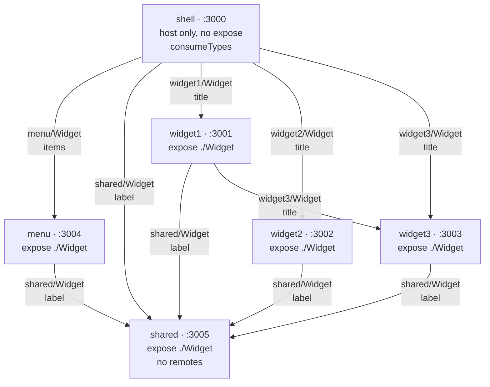
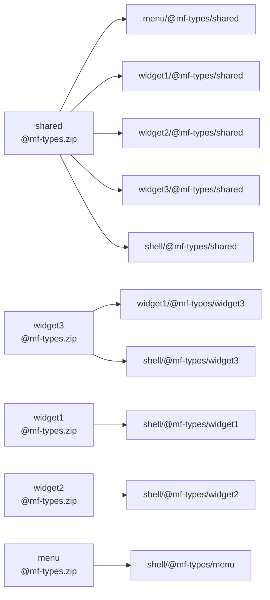

# mf-dashboard-tests

[English](README.md) | [Русский](README.ru.md)

Репозиторий для проверки [mf-dashboard](https://github.com/megahoma/mf-dashboard).

Шелл, меню, три виджета и общий remote `shared`. React 19, TypeScript, Rsbuild, Module Federation 2. Экраны показывают статический текст и пропы. Внешних запросов нет.


## Схема

Браузер открывает `shell` на порту 3000. Стрелка означает загрузку в рантайме. Хост читает `mf-manifest.json` на порту remote, затем `remoteEntry.js`, на который указывает манифест, и рендерит expose `./Widget`. Каждый такой рендер обёрнут в свой `Suspense` и `RemoteBoundary`. Проп `className` необязателен. Подпись на стрелке показывает второй проп, который передаёт родитель.



На странице шелла `shared` рисуется шесть раз: из шелла, из меню, из каждого из трёх виджетов и ещё раз из `widget3`, который загружает `widget1`. Это отдельные рендеры одного remote.

Продюсер с `generateTypes` публикует `@mf-types.zip`. Потребитель с `consumeTypes` копирует архив в свой каталог `@mf-types/<remote>`. После правки `shared` копии обновляются, когда `shared` заново собирает архив, а потребители его скачивают. В собственном архиве потребителя описаны его пропы. Пропы `shared` туда не попадают. Шелл архив не публикует.



## Требования

- Node.js 20.19 или новее
- pnpm 10.34.5

```bash
corepack enable
corepack prepare pnpm@10.34.5 --activate
pnpm install
```

## Запуск

```bash
pnpm dev
```

`pnpm dev` поднимает все шесть серверов. Порты фиксированы. В `remotes` указан `http://127.0.0.1:<port>/mf-manifest.json`. Страницы открываются и по `localhost`.

| Приложение | URL | Роль |
|---|---|---|
| shell | http://localhost:3000 | Хост |
| widget-1 | http://localhost:3001 | Грузит shared и widget-3 |
| widget-2 | http://localhost:3002 | Грузит shared |
| widget-3 | http://localhost:3003 | Грузит shared |
| menu | http://localhost:3004 | Грузит shared |
| shared | http://localhost:3005 | Remote нет |

На http://localhost:3000 видны Menu, Shared from shell, Widget 1 from shell, Widget 2 from shell и Widget 3 from shell. У Widget 1 также есть Widget 3 from widget 1 и Shared from widget 1. Меню показывает Shared from menu и пункты Overview, Widgets, Settings. Widget 2 показывает Shared from widget 2. Оба экземпляра Widget 3 показывают Shared from widget 3. Этих строк нет в HTML, который отдаёт `curl`: они появляются после загрузки remote.

В `.vscode/settings.json` уже записаны шесть приложений для MF Dashboard. Ключ записи совпадает с именем контейнера. `path` указывает каталог приложения, `manifestPath` равен `/mf-manifest.json`, скрипт запуска равен `dev`.

Проверка типов:

```bash
pnpm typecheck
```

Сборка:

```bash
pnpm build
```
